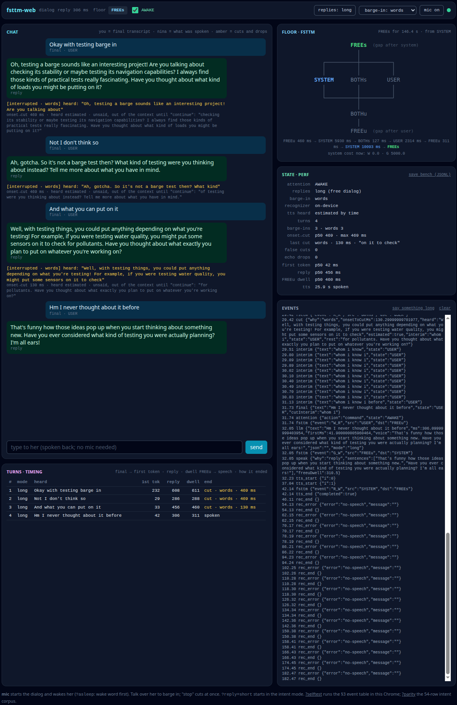

# fsttm-web

A dialog framework for the browser: the FSTTM floor machine (N09-1071, the
finite-state turn-taking model) over Chrome's SpeechRecognition and
speechSynthesis, with wake/sleep attention, barge-in, textual echo
rejection and the heard-text cut. ES modules with no dependencies (`lib/`),
the same library as a Python package (`fsttm_web`) for a Python web server,
one page↔backend wire, and a reference page (`web/`) over a plain
llama-server.

Used by: metis-agent's console.



## The library (lib/)

```
lib/   fsttm.js fsttm.json   the floor machine and its table (the machine as data)
       attention.js          wake / sleep in front of the floor
       dialog.js             browser signals → floor actions: barge-in, echo rejection, the heard-text cut, resume
       tts.js                speechSynthesis with the text actually heard
       ws.js                 the backend adapter over the wire (WsBackend, connect)
       panel.js panel.css    the dialog as a widget panel: the one input and the intent chat
       fixtures/             the floor machine's and attention's cases as data (canonical)
```

```js
import { FSTTM } from 'fsttm-web/fsttm';                  // the floor machine (table: fsttm-web/fsttm.json)
import { Attention } from 'fsttm-web/attention';          // wake / sleep: new Attention({ wakeWords, sleepPhrases, enabled, startAsleep })
import { Dialog, attachRecognizer } from 'fsttm-web/dialog';
import { BrowserTTS, splitSentences } from 'fsttm-web/tts';
import { WsBackend, connect } from 'fsttm-web/ws';         // the wire's adapter (below)
import { Panel, PanelCore } from 'fsttm-web/panel';        // the panel (below); lib/panel.css
```

In a browser without a bundler, an import map points the names at `lib/`
(see `web/index.html`, or `fsttm_web.IMPORT_MAP`).

## Design

- **The floor is ownership, not speech.** `fsttm.js` interprets
  `fsttm.json`: six floor states, the 14 transitions keyed by the
  (system, user) action pair, the action remap, and the paper's §3.2 costs.
  Any interpreter of the table runs `fixtures/fsttm-cases.json`.
- **Attention** sits in front of the floor. ASLEEP, only a wake word is
  acted on; AWAKE, utterances are commands. Sleep only when the assistant is
  addressed by name ("computer, go to sleep"), so a misheard bare phrase
  never turns voice off. The wake words are the application's (`wakeWords`);
  `DEFAULT_WAKE` is a neutral one.
- **The dialog** (`dialog.js`) is pure logic over injected parts
  (recognizer, tts, llm, log). The same event table runs scripted in node
  (`test/dialog.mjs`) and in Chrome (`?selftest`). Barge-in is a policy
  (`words` / `energy` / `none`). A transcript that is only the system's own
  speech is dropped as echo. A short stop phrase cuts at once. "Continue"
  resumes a cut reply from the cut word, with no new LLM call.
- **The heard-text invariant.** On a cut, the dialog history keeps only what
  was heard, up to the cut word, and the unsaid rest stays out of the
  context. `tts.js` knows the heard text from `onboundary`. Voices that fire
  no boundary events (Linux speech-dispatcher) get an estimate from the time
  spoken, marked estimated.

## The panel

`panel.js` is the dialog as a widget a page embeds, the way it embeds a dock. It holds the
**one input**, voice or text: the mic, the text line, the floor and the input's mode. It
also holds the **intent chat**: what was heard or typed, the intent the backend made of it,
and the backend's words, tagged spoken or cut. The panel fills an element the page gives
it and takes the page's colours (`lib/panel.css`: currentColor, `--fw-accent`, `--fw-side`).

```js
const panel = new Panel(document.getElementById('dock'), { backend: await connect(url), table });
window.say = text => panel.say(text);
```

- **One entry.** The text line, a recognized utterance and `panel.say(text)` all take
  one path: the floor's `final()`, the echo and attention rules, then a turn on the
  backend. So a script, a test and a backend's text socket type into the same line as
  a person. A row records each input's source: typed, heard or said.
- **Two channels.** The backend is the main one. A page with a second consumer of the
  voice gives `side: { label, send(text, {id}) → words }`. `flip()` moves the input to it
  (the `flipKey`, Ctrl+Space by default). `hold()`/`release()` is the quasimode: the side
  channel only while the `holdKey` is held (Space by default, never while the focus is in
  a text field). `onChannel(channel, how)` tells the page.
- **The page's own.** `setMode(text)` shows the page's word for the input's mode.
  `onFrame` gets every frame the panel doesn't know (narration it voices itself), and
  `log` every dialog event (a stop phrase, `keyword_stop`, never reaches a turn).
- `PanelCore` is the logic without the DOM (`test/panel.mjs` drives it on a fake backend).
  `web/panel.html` is the panel in a dock over `examples/serve.py`'s stub backend.

## The backend adapter and the wire

The dialog needs one thing from the LLM side, a **backend adapter**:
`turn(id, text, mode, {signal})` → an async iterable of sentences (`mode`:
`intent` | `talk`), and `cut(id, heard)`: turn `id` was heard up to `heard`.
The adapter owns the dialog history. The reference page has two:

- `web/backend/llama.js`: a plain llama-server over `/completion` with
  `cache_prompt`. The intent mode is a two-pass turn: pass 1 is the intent
  JSON under a grammar, pass 2 one spoken line. The talk mode is a free
  dialog. Rendering is Gemma 4's chat template.
- `lib/ws.js` (`fsttm-web/ws`; `web/backend/ws.js` re-exports it): any backend that
  speaks **the wire** on `/ws`. A turn on a closed socket fails at once ("ws closed"),
  never waits, and `send` throws on a closed socket (a caller that may run during a drop
  checks `isOpen` first). `reconnect: ms` opens a dropped socket again (a page left idle loses its
  socket to the server's heartbeat), and `onReopen(backend)` is where the page sends its
  own hello again.

**The wire** (`fsttm_web.protocol`) is JSON text frames on one websocket,
each an object with `ev`:

| direction | frames |
|---|---|
| page → backend | `say_text{id, text, mode}` · `cut{id, heard}` · `heard{id, text}` (a narration was voiced, this much of it) |
| backend → page | `intent{id, intent, voice}` · `talk{id, text, done}` · `error{id, error}` · `narration{id, path, kind, form, line, sentence}` (something to say when the floor is free; form `R` is shown, never voiced) |

**An application extends the wire** with frames of its own, either way. Any
other `ev` is the application's: the library neither defines nor needs it.
`WsBackend` hands unknown frames to `onFrame`, and `send(frame)` sends the
page's own. `parse()` accepts any frame with an `ev`.

## Packages: JS and Python, one source

lib/ is packaged twice, from the same files; nothing is copied by hand.

**JS** (`package.json`, exports as above, `files: lib/`):

```
npm install git+https://github.com/metis-lang-dev/fsttm-web.git#<commit>
npm pack                     # fsttm-web-<version>.tgz
```

A page served by any server points its import map at the installed
`node_modules/fsttm-web/lib/`, or the server mounts it at `/lib/`.

**Python** (`pyproject.toml`, package `fsttm_web`): the same lib/, the
reference page (web/) and its assets (prompt/, grammar/), with a mount
helper for aiohttp and the wire in Python terms:

```
pip install -e 'fsttm-web[aiohttp]'      # editable: reads lib/ and web/ from this checkout
python examples/serve.py                 # the reference page + a stub backend: http://localhost:8397/?backend=ws
```

```python
import fsttm_web                     # LIB, WEB, asset(name), routes(), IMPORT_MAP
from fsttm_web.aiohttp import mount  # mount(app): /lib/, /assets/<name>, the page at / (page=False: lib only)
import fsttm_web.protocol as wire    # the frames, parse(), Echo (a stub backend)
```

A wheel (`pip wheel .`) carries its own copies of lib/, web/ and the
assets, made at build time.

## The reference page (web/)

```
MODEL=<gemma4 gguf> ./run.sh     # llama-server serving the page: http://localhost:8393
```

The dialog runs from page load: type, or press **mic** (it wakes the
assistant). **replies: long** (the default) is free conversation, several
sentences to talk over; **short** is the intent turn of the example, a desk
assistant with a lamp (`prompt/example-prompt.txt`, `grammar/example.gbnf`:
LIGHT_ON, LIGHT_OFF, TIME, CHITCHAT, UNKNOWN). An application gives its own
prompt and grammar to `loadAssets`.

The panels: the chat over the turn timings; the floor diagram (the current
state green, the one just left blue), the numbers and the event log.

URL options:
- `?asleep`: start asleep, so the wake word comes first.
- `?wake=a,b`: the wake words.
- `?reply=short`: start in the intent mode.
- `?backend=llama|ws`: force a backend.
- `?narrate=all|none`: voice every narration, or none.
- `?selftest`: the event table in this Chrome.

**save bench (JSONL)** exports every dialog event, timed.

Styles are Tailwind 3.4.17 with no bundler: `npm run build` turns
`web/src/input.css` into `web/styles.css`, which is committed.
llama-server sends no cache headers, so after an update reload with
Ctrl+Shift+R.

## Tests

```
npm test                         # test/run.mjs (the floor machine and attention on their fixtures) + test/dialog.mjs (the event table) + test/panel.mjs (the panel's logic) + test/ws.mjs (the wire's adapter)
pytest test/test_python.py       # the package: one source, the stub backend, the mount
```

## License

Apache License 2.0 (see `LICENSE`, `NOTICE`).
